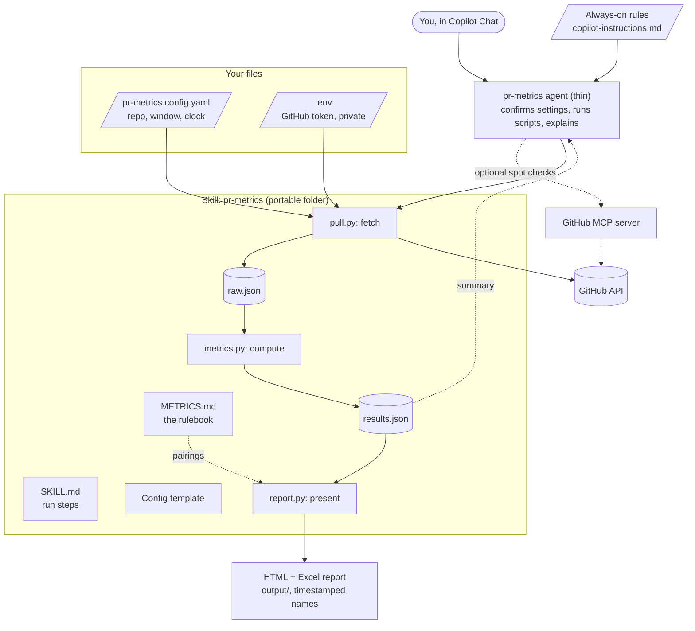
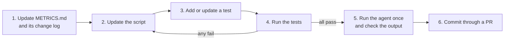

# Maintaining the PR metrics agent

For the person who owns this code base. To just run the agent, see [README.md](README.md).

---

## Architecture

**One rule holds it together: scripts calculate, the agent explains.** The agent never computes a number or converts a date; it quotes ready-made display values from `results.json`.

---

## Design decisions

| Decision                                                          | Why                                                                                                                                                                                                                      | Revisit if                                                                                   |
| ----------------------------------------------------------------- | ------------------------------------------------------------------------------------------------------------------------------------------------------------------------------------------------------------------------ | -------------------------------------------------------------------------------------------- |
| Fetch PR data with `pull.py` (GitHub GraphQL API), not GitHub MCP | About 5 queries instead of 200 to 300 tool calls. The AI never reads raw PR data, so runs cost far less. Reconciliation proves no PRs were lost. Same data gives the same numbers. Tested offline. Runs without Copilot. | MCP gains bulk fetch with counts you can check, or runs need live data the scripts can't get |
| GitHub MCP only for spot checks (guardrail 7)                     | Fits interactive questions about one PR                                                                                                                                                                                  | n/a                                                                                          |
| Scripts calculate, the agent explains                             | In testing, the agent shifted dates and did its own analysis when it touched raw data                                                                                                                                    | n/a                                                                                          |

---

## File map

| Path                                                   | What it is                                                     | Change it when                        |
| ------------------------------------------------------ | -------------------------------------------------------------- | ------------------------------------- |
| `.github/agents/pr-metrics.agent.md`                   | The agent: workflow, guardrails, report format                 | The agent's behaviour must change     |
| `.github/copilot-instructions.md`                      | Always-on rules for every Copilot chat: Python, secrets, scope | Setup or safety rules change          |
| `.github/skills/pr-metrics/SKILL.md`                   | Run steps and how to read results                              | A command or output changes           |
| `.github/skills/pr-metrics/references/METRICS.md`      | **The rulebook:** every definition, pairing and setting        | A metric is added, changed or removed |
| `.github/skills/pr-metrics/scripts/pull.py`            | Fetches merged PRs from GitHub into `output/raw.json`          | New data is needed from GitHub        |
| `.github/skills/pr-metrics/scripts/metrics.py`         | Applies METRICS.md, writes `output/results.json`               | A definition changes                  |
| `.github/skills/pr-metrics/scripts/report.py`          | Writes the HTML and Excel reports                              | The report's layout changes           |
| `.github/skills/pr-metrics/scripts/requirements.txt`   | Packages the scripts need to run                               | A script needs a new package          |
| `.github/skills/pr-metrics/assets/config.example.yaml` | Config template with every setting                             | A setting is added                    |
| `tests/`                                               | Automated tests and saved test data                            | Every code change                     |
| `requirements-dev.txt`                                 | Run-time packages plus the test tool                           | Rarely                                |
| `BACKLOG.md`                                           | Planned work, dropped metrics and why, open questions          | Decisions are made                    |
| `output/`                                              | Generated files. Never committed                               | Never by hand                         |

---

## How a number is produced

Time to merge, from GitHub to the report:

1. **`pull.py`** asks GitHub for every PR merged into the configured branches over the last two windows, plus the CFR evaluation window. It checks the count it received against the count GitHub reported (reconciliation) and stops if they differ.
2. **`metrics.py`** removes bot PRs, assigns each PR to the current or previous window by its merge time, calculates opened-to-merged time, and works out the median and p85. It writes both the raw number (hours) and a display value ("2.7 days").
3. **`report.py`** reads the pairings table in METRICS.md and places each number beside its counter-metric.
4. **The agent** quotes the display values and explains them.

The exact rules are in METRICS.md. This page describes the flow, not the rules.

---

## Changing a metric

| Step                | Why it matters                                                                  |
| ------------------- | ------------------------------------------------------------------------------- |
| 1. METRICS.md first | It is the rulebook. Code that disagrees with it is a bug                        |
| 2. Script           | Usually `metrics.py`; `report.py` only if the display changes                   |
| 3. Test             | Each METRICS.md rule has a test named after it in `tests/test_metrics.py`       |
| 4. Tests            | Copilot prompt: `Run the tests.` All must pass                                  |
| 5. Agent run        | Catches agent-side effects tests can't, e.g. a renamed field it no longer finds |
| 6. Commit           | Message says what changed and why                                               |

**Adding a whole new metric** also means: a pairing row in METRICS.md section 5 (report.py stops if a pairing names a metric it doesn't know), a card in `report.py`, and moving the question from "Planned" to "Measured".

---

## Tests

| Prompt (Copilot, Agent mode, default agent) | What it does                                                        |
| ------------------------------------------- | ------------------------------------------------------------------- |
| `Set up this project for development.`      | Creates `.venv` and installs everything, including the test tool    |
| `Run the tests.`                            | Runs all tests. Expect all passed, shown as a count, e.g. `[96/96]` |

| Test file         | Covers                                                           | Test data                                                                                          |
| ----------------- | ---------------------------------------------------------------- | -------------------------------------------------------------------------------------------------- |
| `test_pull.py`    | Fetching, paging, reconciliation, token handling, rate limits    | Simulated GitHub responses                                                                         |
| `test_metrics.py` | One test group per METRICS.md rule                               | Made-up PRs for exact answers; trimmed real PRs from prometheus/prometheus, cli/cli and grafana/k6 |
| `test_report.py`  | Pairings from METRICS.md, display values, no names, Excel sheets | Real PRs via `metrics.py`                                                                          |

**Before trusting a test change:** break the rule on purpose and check a test fails. A test that can't fail protects nothing.

---

## Guardrails and why they exist

Each guardrail in the agent file came from a real failure found in testing.

| Guardrail                                                              | Failure it prevents                                                                              |
| ---------------------------------------------------------------------- | ------------------------------------------------------------------------------------------------ |
| Numbers and dates only from `results.json` display values              | The agent shifted window dates by a whole month when converting them itself                      |
| Run only the three scripts; never read scripts or `raw.json`           | The agent ran its own analysis and reported a fact that wasn't in `results.json`                 |
| Reread `results.json` on every run                                     | In the same chat, the agent reused an earlier explanation that the new data had already answered |
| Primary metric always with its counter-metric, including short answers | A one-line answer quoted time to merge alone                                                     |
| Team level only, no names                                              | Per-person leaderboards, the classic metrics anti-pattern                                        |
| Never open `.env`                                                      | The token entering the AI's context                                                              |
| Commands name `.venv\Scripts\python` directly                          | File search skips `.venv`, so the agent fell back to the wrong Python                            |

**After any change to the agent file:** test in a **new chat**. A new guardrail once closed one gap and opened another.

---

## Branches

Set `branches` in `pr-metrics.config.yaml` to the branch your team's everyday PRs merge into. Usually that is `main`. Teams that merge features into `develop` first should use `branches: [develop]`.

---

## Appendix: exact commands

For when Copilot isn't available. Run from the project folder in the VS Code terminal.

| Purpose                  | Command                                                                                                                                            |
| ------------------------ | -------------------------------------------------------------------------------------------------------------------------------------------------- |
| Create the environment   | `python -m venv .venv`                                                                                                                             |
| Install for running only | `.venv\Scripts\python -m pip install -r .github\skills\pr-metrics\scripts\requirements.txt`                                                        |
| Install for development  | `.venv\Scripts\python -m pip install -r requirements-dev.txt`                                                                                      |
| Run the tests            | `.venv\Scripts\python -m pytest`                                                                                                                   |
| Fetch                    | `.venv\Scripts\python .github\skills\pr-metrics\scripts\pull.py --config pr-metrics.config.yaml --out output\raw.json`                             |
| Compute                  | `.venv\Scripts\python .github\skills\pr-metrics\scripts\metrics.py --config pr-metrics.config.yaml --in output\raw.json --out output\results.json` |
| Report                   | `.venv\Scripts\python .github\skills\pr-metrics\scripts\report.py --in output\results.json --out-dir output`                                       |

No activation step is needed: each command calls the project's Python directly.

**Script exit codes**

| Code | Meaning                                                          |
| ---- | ---------------------------------------------------------------- |
| 0    | Success                                                          |
| 2    | Config, token or input problem; the message says which           |
| 3    | Incomplete data (reconciliation mismatch); rerun the fetch       |
| 4    | GitHub API error or rate limit; the message gives the reset time |
