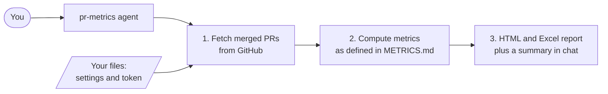

# PR metrics agent

A GitHub Copilot agent that measures how pull requests move through review in a GitHub repo, and explains the results.

Every metric traces back to a goal and a question (Goal Question Metric), is paired with a counter-metric so it cannot be gamed, and is computed by scripts. The agent orchestrates, checks the data and explains the results; it never does the arithmetic.

Are you maintaining this project? See [MAINTAIN.md](MAINTAIN.md).

---

## How it works

---

## What it measures

| Question                          | Metric                                                             | Always shown with                                        |
| --------------------------------- | ------------------------------------------------------------------ | -------------------------------------------------------- |
| How long does a PR take to merge? | **Time to merge:** PR opened to merged (median and p85)            | Change failure rate, so speed can't hide falling quality |
| Are merged changes stable?        | **Change failure rate (estimate):** % of merged PRs later reverted | Time to merge, so caution can't hide slowing down        |

### Reading the numbers

- **Median:** The median is the typical PR. Line up every PR from fastest to slowest and take the one in the middle. We use it instead of the average because one PR stuck open for months drags the average up even when almost every PR merged quickly. The median ignores those few extreme cases, so it tells you what normally happens. 
- **p85:** time within which 85% of PRs merged.
- How each metric is calculated, with diagrams: [METRICS.md](.github/skills/pr-metrics/references/METRICS.md).

---

## Run it

| Step                  | Who                                | What to do                                                                                                                                                                                                                                                                         |
| --------------------- | ---------------------------------- | ---------------------------------------------------------------------------------------------------------------------------------------------------------------------------------------------------------------------------------------------------------------------------------- |
| 1. Get a GitHub token | You                                | On github.com: profile picture → **Settings** → **Developer settings** → **Personal access tokens** → **Fine-grained tokens** → **Generate new token**. Expiry 30 days. Repository access: **Public repositories (read-only)**, or read access to your private repo                |
| 2. Store the token    | You                                | Copy `.env.example` to `.env` and paste the token after `GITHUB_TOKEN=`. Never share or commit `.env` or paste the token into Copilot Chat.                                                                                                                                        |
| 3. Set up             | Copilot, Agent mode, default agent | `Set up this project to run the agent.`                                                                                                                                                                                                                                            |
| 4. Choose the repo    | You                                | In `pr-metrics.config.yaml`, set `repo:` (e.g. `grafana/k6`) and `window_days:` (days measured, compared with the same number of days before; default 30). If your team merges everyday PRs into a branch other than the default (e.g. `develop`), also set `branches: [develop]`. |
| 5. Run                | Copilot, **pr-metrics** agent      | `Run PR metrics for the configured repo.` Reply **OK** when it shows the settings                                                                                                                                                                                                  |

The agent then summarises the results in chat and writes two reports to the `output` folder.

---

## Read the report

Files: `output/report-<repo>-<date>-<time>UTC.html` and `.xlsx`, named after when the data was fetched.

| Section                | What it tells you                                                          |
| ---------------------- | -------------------------------------------------------------------------- |
| Speed and stability    | Time to merge beside the change failure rate, this window against the last |
| By PR size             | Whether bigger PRs take longer                                             |
| Change failure details | Reverted PRs, and fix PRs worth a look                                     |
| Data quality           | Whether the numbers can be trusted: PRs excluded and why, small samples    |
| PRs counted            | Every PR behind the numbers, linked to GitHub                              |

---

## Key files

| File                                                          | What it is for                                                                                                                                         | Who edits it                           |
| ------------------------------------------------------------- | ------------------------------------------------------------------------------------------------------------------------------------------------------ | -------------------------------------- |
| [METRICS.md](.github/skills/pr-metrics/references/METRICS.md) | **The rulebook.** What each number means, exactly how it is calculated, and which numbers are shown together. The agent and the scripts both follow it | Owners only, when a definition changes |
| [BACKLOG.md](BACKLOG.md)                                      | **The to-do list and decision record.** Metrics planned but not yet built, metrics dropped and why, open questions. The agent never reads it           | Owners                                 |
| `pr-metrics.config.yaml`                                      | **Your settings:** which repo, which branches, how many days                                                                                           | You                                    |
| `.env`                                                        | **Your GitHub token.** Private, never committed                                                                                                        | You                                    |
| [MAINTAIN.md](MAINTAIN.md)                                    | **The owner's guide:** how it is built, how to change a metric, tests                                                                                  | Owners                                 |

---

## Known limits

- A run stops if more than 1,000 PRs match. Use a shorter `window_days`.
- Only merged PRs into the branches you choose are counted.
- Change failure rate is an estimate: it only counts PRs later reverted, so it always comes out lower than reality.
- Cycle time is not measured: commit dates proved unreliable (details in BACKLOG.md).
